# Guia Arquitetural & Bibliografia Técnica Recomendada
## Sentinela Study / JW Study Assistant — Da Engenharia Reversa à Inteligência Artificial

> **Versão do Documento:** 1.0.0  
> **Data:** Novembro de 2026  
> **Status:** Referência Arquitetural e Plano de Formação Técnica  
> **Projeto Base:** `c:\Users\Pablus Vinicius\Downloads\jw\sentinela_study`

---

## 📑 Sumário

1. [Visão Geral & Filosofia de Engenharia](#1-visão-geral--filosofia-de-engenharia)
2. [Raio-X Arquitetural: Os 7 Pilares do Projeto](#2-raio-x-arquitetural-os-7-pilares-do-projeto)
   - [Pilar 1: Engenharia Reversa, Formatos Proprietários (.JWPUB) & Criptografia](#pilar-1-engenharia-reversa-formatos-proprietários-jwpub--criptografia)
   - [Pilar 2: Compiladores, Expressões Regulares & Parsing Léxico de Texto](#pilar-2-compiladores-expressões-regulares--parsing-léxico-de-texto)
   - [Pilar 3: Arquitetura Limpa, Padrões de Projeto & Flutter/Dart Avançado](#pilar-3-arquitetura-limpa-padrões-de-projeto--flutterdart-avançado)
   - [Pilar 4: Inteligência Artificial, RAG (Retrieval-Augmented Generation) & Prompts](#pilar-4-inteligência-artificial-rag-retrieval-augmented-generation--prompts)
   - [Pilar 5: Bancos de Dados Embarcados & Sistemas Offline-First](#pilar-5-bancos-de-dados-embarcados--sistemas-offline-first)
   - [Pilar 6: Engenharia de Testes, Qualidade de Software & TDD](#pilar-6-engenharia-de-testes-qualidade-de-software--tdd)
   - [Pilar 7: Design de Interface (UI/UX), Modo AMOLED & Acessibilidade](#pilar-7-design-de-interface-uiux-modo-amoled--acessibilidade)
3. [Bibliografia Essencial: 14 Livros Clássicos de Referência](#3-bibliografia-essencial-14-livros-clássicos-de-referência)
4. [Trilha de Estudos Sugerida (Roadmap Cronológico em 3 Fases)](#4-trilha-de-estudos-sugerida-roadmap-cronológico-em-3-fases)
5. [Matriz de Melhorias e Próximos Passos de Evolução](#5-matriz-de-melhorias-e-próximos-passos-de-evolução)

---

## 1. Visão Geral & Filosofia de Engenharia

O **Sentinela Study** transcende um aplicativo móvel comum de leitura: ele é um ecossistema completo de engenharia de software que unifica **engenharia reversa de formatos proprietários**, **criptografia simétrica**, **compiladores/parsers textuais**, **arquitetura móvel de alto desempenho**, **sistemas offline-first** e **inteligência artificial generativa contextualizada (RAG)**.

O projeto opera sob quatro restrições rigorosas de qualidade:
1. **Teto de Manutenibilidade do ECC:** Nenhum arquivo de código-fonte excede o teto de 800 linhas, mantendo alta coesão e baixo acoplamento modular.
2. **Imutabilidade e Segurança:** Modelos com métodos imutáveis (`copyWith`, `List.unmodifiable`), descarte estrito de recursos para vazamento zero de memória (*leak prevention*) e proteção contra falhas como *Zip Slip*.
3. **Desenvolvimento Orientado a Testes (TDD):** Cobertura ampla (77+ testes automatizados unitários, de integração e visuais E2E).
4. **Fidelidade Teológica e Visual:** Réplica exata das 6 cores canônicas de marcação do JW Library original, layout escuro AMOLED e IA estritamente ancorada em fontes oficiais (`wol.jw.org` / `jw.org`), sem saudações ou alucinações doutrinais.

---

## 2. Raio-X Arquitetural: Os 7 Pilares do Projeto

```
+-----------------------------------------------------------------------------------+
|                                SENTINELA STUDY                                    |
+-------------------+-------------------------------+-------------------------------+
| 1. CRIPTOGRAFIA   | 2. PARSING & COMPILADORES     | 3. ARQUITETURA FLUTTER        |
| .jwpub, AES-128,  | BibleCitationParser,          | Clean Architecture, Isolates, |
| SHA-256 XOR, Zlib | ArticleParser, Interval Slicing| Limite 800 linhas, Imutável   |
+-------------------+-------------------------------+-------------------------------+
| 4. IA & RAG       | 5. OFFLINE-FIRST & SQLITE     | 6. TDD & QUALIDADE            |
| Gemini, WOL search| Banco embutido, CDN Discovery,| 77 testes, zero leaks,        |
| Grounded prompt   | Checksums MD5 / SHA-256       | flutter analyze 0 issues      |
+-------------------+-------------------------------+-------------------------------+
| 7. UI/UX & AMOLED | 6 Cores Canônicas, Toolbar Flutuante, WCAG 2.2, Gestos        |
+-----------------------------------------------------------------------------------+
```

### Pilar 1: Engenharia Reversa, Formatos Proprietários (.JWPUB) & Criptografia
- **Arquivos-Chave:** 
  - `lib/services/jwpub_service.dart`
  - `lib/services/jw_backup_service.dart`
- **Mecanismos Internos:**
  - O formato `.jwpub` é um arquivo compactado ZIP contendo um manifesto JSON (`manifest.json`), imagens e arquivos HTML criptografados com extensão `.html`.
  - **Derivação de Chaves:** O aplicativo deriva chaves AES de 16 bytes e vetores de inicialização (IV) de 16 bytes a partir de um segredo mestre combinado via SHA-256 com máscaras XOR específicas por tipo de publicação e pelo `issueTagNumber`.
  - **Cifra Simétrica:** Descriptografia em modo **AES-128-CBC** com subsequente descompressão **Zlib/Deflate**.
  - **Prevenção de Zip Slip:** Validação estrita de caminhos de extração para impedir ataques de *Path Traversal*.

### Pilar 2: Compiladores, Expressões Regulares & Parsing Léxico de Texto
- **Arquivos-Chave:**
  - `lib/services/bible_citation_parser.dart`
  - `lib/services/article_parser.dart`
  - `lib/widgets/highlight_text_helper.dart`
- **Mecanismos Internos:**
  - **Análise Léxica Avançada:** Reconhecimento de todos os 66 livros bíblicos em múltiplos idiomas (PT, EN, ES), abreviações com e sem ponto, números arábicos e romanos, versículos simples (`v. 14`), listas com vírgula (`vv. 1, 2`), intervalos com traço ou hífen (`13:4-8` e `16:23–17:2`) e herança sintática de livro anterior (`2 Sam. 15:13, 14; 18:33`).
  - **Extração Semântica de HTML:** Mapeamento de nós com `data-pnum`, identificação de perguntas contextuais que cobrem blocos de parágrafos e pareamento automático de ilustrações internas e legendas.
  - **Interval Slicing:** O `HighlightTextHelper` particiona o texto contínuo em segmentos (`InlineSpan` / `TextSpan`) mesclando marcações de usuário sem quebrar links clicáveis ou números sobrescritos.

### Pilar 3: Arquitetura Limpa, Padrões de Projeto & Flutter/Dart Avançado
- **Arquivos-Chave:**
  - `lib/screens/article_reader_screen.dart` (729 linhas)
  - `lib/screens/bible_reader_screen.dart` (746 linhas)
  - `lib/widgets/study_paragraph_text.dart`
  - `lib/widgets/paragraph_answer_box.dart`
  - `lib/widgets/article_review_section.dart`
  - `lib/widgets/bible_study_sheet.dart`
  - `lib/widgets/note_editor_dialog.dart`
- **Mecanismos Internos:**
  - **Decomposição Modular Estrita:** Respeito integral ao teto de 800 linhas do ECC por meio de extração de widgets especialistas de UI e caixas de diálogo modais.
  - **Gerenciamento de Ciclo de Vida & Recursos:** Limpeza de listeners de texto (`TextEditingController`) e de gestos (`TapGestureRecognizer`) no `dispose()`, impedindo fugas de memória (*memory leaks*).
  - **Imutabilidade e Concorrência:** Uso de construtores `const`, classes imutáveis com `copyWith` e isolamento de operações síncronas de CPU via Isolates.

### Pilar 4: Inteligência Artificial, RAG (Retrieval-Augmented Generation) & Prompts
- **Arquivos-Chave:**
  - `lib/services/wol_search_service.dart`
  - `lib/services/ai_explanation_service.dart`
  - `lib/services/gemini_service.dart`
  - `lib/widgets/explanation_sheet.dart`
- **Mecanismos Internos:**
  - **Busca Oficial em Tempo Real (Scraper Inteligente):** Consulta o endpoint oficial MEPS do Brasil (`https://wol.jw.org/pt/wol/s/r5/lp-t`), extraindo títulos e trechos de obras de referência (*Tradução do Novo Mundo com Notas de Estudo*, *Estudo Perspicaz das Escrituras* e *A Sentinela*).
  - **RAG com Grounding Estrito:** Injeta as passagens oficiais extraídas diretamente no contexto do modelo Gemini (`gemini-2.5-flash` / `gemini-3.5-flash-lite`). O prompt proíbe saudações ("Olá", "Certamente"), proíbe teologias externas e exige resposta sintética em 1 ou 2 parágrafos com saída JSON estruturada contendo citação e link direto do WOL.

### Pilar 5: Bancos de Dados Embarcados & Sistemas Offline-First
- **Arquivos-Chave:**
  - `lib/services/pub_media_client.dart`
  - `lib/services/jw_api_service.dart`
  - `lib/services/highlight_storage_service.dart`
  - `lib/services/study_storage_service.dart`
- **Mecanismos Internos:**
  - **Descoberta Dinâmica de Mídia:** Consulta a API CDN (`GETPUBMEDIALINKS`), priorizando formatos `JWPUB` sobre `EPUB` e garantindo o dialecto correto (Português do Brasil `T` vs Portugal `TPO`).
  - **Validação Criptográfica de Integridade:** Validação de integridade do arquivo baixado via hash MD5 (32 caracteres hexadecimais) e SHA-256.
  - **Armazenamento Híbrido:** SQLite nativo para indexação textual pesada e `SharedPreferences` para respostas, anotações e marcações indexadas por chaves compostas (`bible_livro_capitulo` ou `sentinela_artigoId`).

### Pilar 6: Engenharia de Testes, Qualidade de Software & TDD
- **Arquivos-Chave:**
  - `test/highlight_and_wol_test.dart`
  - `test/bible_service_test.dart`
  - `test/bible_citation_parser_test.dart`
  - `test/bible_ui_e2e_test.dart`
  - `test/pub_media_client_test.dart`
  - `test/jwpub_service_test.dart`
- **Mecanismos Internos:**
  - **Ciclo Red-Green-Refactor:** Criação prévia de testes de regressão antes da implementação final.
  - **Suíte Abrangente:** 77 testes automatizados ativos cobrindo testes unitários de modelos, criptografia, decodificação de payloads, ordenação de marcações e testes de renderização de widgets com mocks controlados (`setMockInitialValues`).

### Pilar 7: Design de Interface (UI/UX), Modo AMOLED & Acessibilidade
- **Arquivos-Chave:**
  - `lib/widgets/jw_text_selection_toolbar.dart`
  - `lib/models/user_highlight_model.dart`
- **Mecanismos Internos:**
  - **Paleta Canônica Exata:** Amarelo (`#FFF37A`), Verde (`#B7E492`), Azul (`#9FB9E3`), Roxo (`#C1A7E2`), Rosa (`#F698BC`) e Laranja (`#FFBA8A`).
  - **Dark AMOLED Puro (`#000000`):** Máxima economia de energia em telas OLED/AMOLED e menor fadiga ocular em leituras extensas.
  - **Toolbar Flutuante Customizada:** Implementada via `SelectionArea` e `contextMenuBuilder`, replicando a experiência nativa do JW Library.

---

## 3. Bibliografia Essencial: 14 Livros Clássicos de Referência

Abaixo estão os livros fundamentais recomendados, organizados por relevância e impacto direto sobre o código do projeto:

### Bloco A: Criptografia, Segurança & Engenharia Reversa
1. **"Serious Cryptography: A Practical Introduction to Modern Encryption"**  
   *Autor:* Jean-Philippe Aumasson | *Editora:* No Starch Press  
   - **O que ensina:** Modos de operação de cifras de bloco (ECB, CBC, CTR, GCM), vetores de inicialização (IV), ataques de padding, funções de derivação de chave (KDF, PBKDF2, HMAC, SHA-2/3) e armadilhas comuns em implementação.  
   - **Por que aplicar no projeto:** Explica a teoria matemática exata utilizada na rotina `JwpubCryptoKeys` de descriptografia dos arquivos `.jwpub` e ensina a proteger chaves locais de API (Gemini) contra extração de memória.

2. **"Practical Reverse Engineering: x86, x64, ARM, Windows Kernel, Reversing Tools, and Obfuscation"**  
   *Autores:* Bruce Dang, Alexandre Gazet, Elias Bachaalany | *Editora:* Wiley  
   - **O que ensina:** Descompilação de código de baixo nível, desofuscação, rastreamento de chamadas de sistema e reconstrução de protocolos fechados.  
   - **Por que aplicar no projeto:** Fornece a bagagem necessária para inspecionar novos binários e pacotes de atualização do JW Library, permitindo identificar futuras alterações em bancos de dados e esquemas de notas.

3. **"Android Security Internals: An In-Depth Guide to Android's Security Architecture"**  
   *Autor:* Nikolay Elenkov | *Editora:* No Starch Press  
   - **O que ensina:** Estrutura interna do Android: isolamento UID de processos, permissões, armazenamento seguro de chaves com Android Keystore, segurança de rede e SQLite embarcado.  
   - **Por que aplicar no projeto:** Essencial para blindar o APK gerado contra adulterações e garantir o armazenamento seguro dos dados do usuário.

---

### Bloco B: Compiladores, Expressões Regulares & Análise Léxica
4. **"Mastering Regular Expressions" (3ª Edição)**  
   *Autor:* Jeffrey E. F. Friedl | *Editora:* O'Reilly Media  
   - **O que ensina:** Como os motores de regex avaliam expressões (DFA vs NFA), otimização de busca em textos longos, prevenção de *Catastrophic Backtracking* e técnicas avançadas com *Lookaheads* e *Lookbehinds*.  
   - **Por que aplicar no projeto:** O `BibleCitationParser` lida com centenas de padrões textuais complexos. Dominar esse livro permite criar regexes ultra-performáticas que analisam capítulos bíblicos inteiros em frações de milissegundo.

5. **"Compilers: Principles, Techniques, and Tools" (O Livro do Dragão)**  
   *Autores:* Alfred V. Aho, Monica S. Lam, Ravi Sethi, Jeffrey D. Ullman | *Editora:* Pearson  
   - **O que ensina:** Análise léxica (Lexers), análise sintática (Parsers LL/LR), árvores sintáticas abstratas (AST) e geração de código.  
   - **Por que aplicar no projeto:** Permite evoluir os parsers de texto do app para um mini-compilador formal, capaz de reconhecer citações e referências cruzadas em dezenas de idiomas com gramáticas bem definidas.

---

### Bloco C: Arquitetura Limpa, Padrões & Código Manutenível
6. **"Clean Architecture: A Craftsman's Guide to Software Structure and Design"**  
   *Autor:* Robert C. Martin ("Uncle Bob") | *Editora:* Prentice Hall  
   - **O que ensina:** Separação estrita em camadas (Entidades, Casos de Uso, Controladores e Frameworks), Inversão de Dependência (DIP) e isolamento do domínio de negócio.  
   - **Por que aplicar no projeto:** Facilita a manutenção do limite de 800 linhas do ECC, permitindo que a lógica de estudo, notas e IA opere independentemente do Flutter ou de APIs externas.

7. **"Refactoring: Improving the Design of Existing Code" (2ª Edição)**  
   *Autor:* Martin Fowler | *Editora:* Addison-Wesley  
   - **O que ensina:** Catálogo sistemático de refatorações (Extrair Classe, Substituir Condicional por Polimorfismo, Mover Método) preservando o comportamento funcional.  
   - **Por que aplicar no projeto:** É o manual prático para manter arquivos grandes (como os leitores de Bíblia e Sentinela) divididos em componentes pequenos, coesos e reutilizáveis.

8. **"Flutter in Action"**  
   *Autor:* Eric Windmill | *Editora:* Manning Publications  
   - **O que ensina:** Funcionamento íntimo do framework Flutter: pipeline de renderização, árvore de elementos, render objects, animações e gestão avançada de estado.  
   - **Por que aplicar no projeto:** Permite criar widgets de alta performance para renderizar milhares de versículos e parágrafos sem quedas na taxa de quadros (60/120 FPS).

---

### Bloco D: Inteligência Artificial, RAG & LLMs
9. **"Prompt Engineering for Generative AI: Future-Proof Inputs for Reliable Outputs"**  
   *Autores:* James Phoenix & Mike Taylor | *Editora:* O'Reilly Media  
   - **O que ensina:** Técnicas avançadas de Few-Shot Prompting, saídas estruturadas em JSON, técnicas de contenção de alucinação e controle de temperatura e raciocínio.  
   - **Por que aplicar no projeto:** Permite extrair respostas concisas, sem preâmbulos e 100% alinhadas com as diretrizes do `AiExplanationService` e `GeminiService`.

10. **"Generative AI on AWS: Building Context-Aware Multimodal Reasoning Applications"**  
    *Autores:* Chris Fregly, Antje Barth, Shelbee Eigenbrode | *Editora:* O'Reilly Media  
    - **O que ensina:** Arquitetura de sistemas RAG (Retrieval-Augmented Generation), busca vetorial (Embeddings), modelos de reranking e injeção semântica de contexto.  
    - **Por que aplicar no projeto:** Base para evoluir a busca no WOL para um sistema de IA híbrido com busca vetorial offline embutida no próprio dispositivo móvel.

---

### Bloco E: Bancos de Dados & Sistemas Offline-First
11. **"Designing Data-Intensive Applications: The Big Ideas Behind Reliable, Scalable, and Maintainable Systems" (DDIA)**  
    *Autor:* Martin Kleppmann | *Editora:* O'Reilly Media  
    - **O que ensina:** Estruturas de armazenamento (B-Trees, SSTables), modelos de concorrência, transações, consistência eventual e replicação de dados entre nós desconectados.  
    - **Por que aplicar no projeto:** O guia supremo para projetar sincronização de anotações e marcações entre múltiplos dispositivos sem perdas ou conflitos de edição (CRDTs).

12. **"SQLite Database System: Design and Implementation"**  
    *Autor:* Sibsankar Haldar | *Editora:* Springer  
    - **O que ensina:** Arquitetura interna do SQLite: gerenciador de páginas, cache de B-Tree, journal de recuperação, modo WAL (Write-Ahead Logging) e otimizador de consultas (VDBE).  
    - **Por que aplicar no projeto:** Otimiza as consultas em bancos `.jwpub` volumosos com milhões de caracteres e dezenas de tabelas de índices textuais.

---

### Bloco F: Testes de Software & Qualidade
13. **"Unit Testing Principles, Practices, and Patterns"**  
    *Autor:* Vladimir Khorikov | *Editora:* Manning Publications  
    - **O que ensina:** O que distingue um bom teste de um teste frágil, uso correto de Dublês de Teste (Mocks vs Stubs), testes de saída vs testes de estado e arquitetura voltada para testabilidade.  
    - **Por que aplicar no projeto:** Mantém a suíte de testes robusta e resiliente, garantindo que refatorações não quebrem funcionalidades antigas.

---

### Bloco G: Design de Interface, UX & Acessibilidade
14. **"Refactoring UI"**  
    *Autores:* Adam Wathan & Steve Schoger  
    - **O que ensina:** Guia prático de design para engenheiros: hierarquia visual com cores e pesos tipográficos, espaçamentos consistentes, estados de clique e contrastes elegantes.  
    - **Por que aplicar no projeto:** Essencial para dar polimento visual superior aos leitores, painéis de notas, sheets de IA e cartões de estudo.

---

## 4. Trilha de Estudos Sugerida (Roadmap Cronológico em 3 Fases)

Para maximizar a absorção prática de conhecimento sem sobrecarga:

```mermaid
gantt
    title Roadmap de Estudos Recomendado
    dateFormat  X
    axisFormat %s
    section Fase 1: Fundamentos & Arquitetura
    Clean Architecture (Robert C. Martin)       :active, 0, 30
    Refactoring (Martin Fowler)                :active, 15, 45
    Refactoring UI (Adam Wathan)               :active, 30, 60
    section Fase 2: Formatos, Criptografia & Texto
    Serious Cryptography (J.P. Aumasson)       :45, 80
    Mastering Regular Expressions (J. Friedl)  :60, 95
    Practical Reverse Engineering (B. Dang)    :75, 110
    section Fase 3: Dados, Qualidade & IA
    Unit Testing (Vladimir Khorikov)           :95, 125
    Designing Data-Intensive Apps (Kleppmann)  :110, 150
    Prompt Engineering for GenAI (Phoenix)     :130, 165
```



---

## 5. Matriz de Melhorias e Próximos Passos de Evolução

Inspirados na literatura técnica apresentada, os seguintes aprimoramentos arquiteturais podem ser considerados para versões futuras:

| Área | Melhoria Proposta | Livro Base de Referência |
| :--- | :--- | :--- |
| **Criptografia & Armazenamento** | Encriptar a chave do Gemini em repouso no `flutter_secure_storage` usando hardware Keystore/Keyring nativo. | *Android Security Internals* (Elenkov) |
| **Parsing Bíblico** | Implementar gerador de autômato determinístico para o `BibleCitationParser`, com cache de compilação de regex. | *Mastering Regular Expressions* (Friedl) |
| **Banco de Dados** | Habilitar modo WAL (*Write-Ahead Logging*) e índices compostos nas consultas SQLite dos arquivos `.jwpub`. | *SQLite Database System* (Haldar) |
| **Inteligência Artificial (RAG)** | Cache local de respostas frequentes com hash do parágrafo, reduzindo em até 80% o consumo de tokens na API do Gemini. | *Designing Machine Learning Systems* (Huyen) |
| **Sincronização Nuvem** | Protocolo de exportação e sincronização de notas e marcações sem conflitos baseado em CRDTs/JSON diffs. | *Designing Data-Intensive Applications* (Kleppmann) |
| **Performance de Renderização** | Janelamento virtual com `ListView.builder` granular e isolamento de reconstruções em `RepaintBoundary`. | *Flutter in Action* (Windmill) |

---

*Documento gerado e catalogado no repositório para consulta contínua da equipe de desenvolvimento.*
